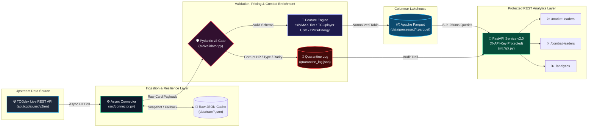

# Pokémon TCG Market Valuation & Combat Analytics API (v2.0)

**Author:** Ashutosh Tembhekar  
[](https://github.com/AshutoshTembhekar)
[](https://www.linkedin.com/in/ashutoshtembhekar/)


> **Executive Summary:** A production-grade **Forward-Deployed Data Engineering (FDE)** microservice built with **FastAPI**, **Pydantic v2**, and **Apache Parquet**. Extends live TCGdex ingestion into **secondary market valuation (TCGplayer & Cardmarket)**, **rulebox mechanic classification (`ex`, `VMAX`, `VSTAR`, `V`, `GX`)**, and **combat damage efficiency analytics** persisted in columnar Parquet storage.

---

## System Architecture (v2.0)



---

## Key Engineering & Analytical Capabilities

| Capability | Module | Implementation Detail |
| :--- | :--- | :--- |
| **Multi-Source Market Pricing** | `src/validator.py` | Extracts live USD market prices from `pricing.tcgplayer` (`holofoil`, `normal`, `reverse-holofoil`) with automated EUR-to-USD fallback from `pricing.cardmarket.trend`. |
| **Rulebox Mechanic Classifier** | `src/validator.py` | Regex-based domain taxonomy tagging cards into `ex`, `VMAX`, `VSTAR`, `V`, `GX`, `EX (Classic)`, or `Standard` tiers. |
| **Combat & Energy Efficiency** | `src/validator.py` | Parses multi-attack movesets to extract `primary_attack_name`, `max_attack_damage`, `primary_attack_energy_cost`, `damage_per_hp_ratio`, and `damage_per_energy_ratio`. |
| **Schema Contract & Quarantine** | `src/validator.py` | Enforces positive integer HP, elemental typing, and rarity classifications; isolates malformed payloads into `quarantine_log.json`. |
| **Columnar Parquet & FastAPI** | `src/api.py` | Persists enriched datasets to Apache Parquet (`pyarrow`) and serves `X-API-Key` protected market and combat leaderboard endpoints in `< 250ms`. |

---

## Repository Structure

| Path | Layer | Description |
| :--- | :--- | :--- |
| `.github/workflows/ci.yaml` | **CI/CD** | Automated GitHub Actions workflow running Ruff static linting and Pytest on every push |
| `src/connector.py` | **Ingestion** | Asynchronous HTTPX client fetching TCGdex expansion payloads with raw JSON snapshotting |
| `src/validator.py` | **Quality & Pricing** | Pydantic v2 validation gate, `ex`/`VMAX`/`GX` classifier, TCGplayer/Cardmarket price parser, and quarantine router |
| `src/api.py` | **Serving** | FastAPI v2.0 microservice exposing sync, filtered search, market valuation, and combat leaderboard routes |
| `tests/test_api.py` | **Testing** | Automated unit and integration test suite verifying auth enforcement, `ex` pricing extraction, combat ratios, and quarantine |
| `postman/` | **API Suite** | Portable Postman v2.1 collection and local environment configuration |
| `data/raw/` | **Bronze Layer** | Local raw JSON snapshots (`{set_id}.json`) for deterministic offline fallback |
| `data/processed/` | **Silver/Gold Layer** | Enriched Apache Parquet files (`{set_id}.parquet`) and `quarantine_log.json` |
| `requirements.txt` | **Dependencies** | Pinned Python runtime and testing packages (`fastapi`, `pydantic`, `pyarrow`, `pandas`, `httpx`, `pytest`, `ruff`) |

---

## API Reference (v2.0)

All `/v1/*` endpoints require the header `X-API-Key: fde-tcg-dev-key-2026` (configurable via `FDE_API_KEY`).

| Method | Endpoint | Auth | Latency SLA | Description |
| :--- | :--- | :---: | :---: | :--- |
| `GET` | `/health` | Public | `< 50ms` | Liveness and version check (`v2.0.0`) |
| `POST` | `/v1/sync/set/{set_id}?limit=130` | Required | Upstream bound | Ingests expansion cards, extracts USD market prices & mechanic tiers, and writes `{set_id}.parquet` |
| `GET` | `/v1/cards?set_id=sv03&mechanic_tier=ex` | Required | `< 250ms` | Queries Parquet store with `primary_type`, `mechanic_tier`, `min_hp`, and `min_price_usd` filters |
| `GET` | `/v1/sets/{set_id}/market-leaders` | Required | `< 250ms` | Ranks highest-valued cards in USD and computes average/max prices across mechanic tiers |
| `GET` | `/v1/sets/{set_id}/combat-leaders` | Required | `< 250ms` | Ranks top heavy-hitter cards by `max_attack_damage` and `damage_per_energy_ratio` |
| `GET` | `/v1/sets/{set_id}/analytics` | Required | `< 250ms` | Computes rarity distribution, mechanic tier counts, mean HP by type, and top damage-per-HP cards |
| `GET` | `/v1/quarantine` | Required | `< 100ms` | Returns rejected card payloads alongside exact Pydantic/domain failure reasons |

---

## Live Execution Output: *Scarlet & Violet — Obsidian Flames (`sv03`)*

Ingesting **130 cards** from the live `sv03` expansion (`POST /v1/sync/set/sv03?limit=130`) yielded **130 validated records** and **0 quarantined records**, automatically isolating all **14 `ex` rulebox cards** with live TCGplayer holofoil valuations.

### 1. Top 10 Highest-Valued Cards (`GET /v1/sets/sv03/market-leaders`)

| Rank | Card ID | Card Name | Rarity | Mechanic Tier | Market Price (USD) | Price Source |
| :---: | :--- | :--- | :--- | :---: | :---: | :--- |
| 1 | `sv03-125` | **Charizard ex** | Double rare | `ex` | **$5.22** | `tcgplayer:holofoil` |
| 2 | `sv03-082` | **Clefable ex** | Double rare | `ex` | **$1.16** | `tcgplayer:holofoil` |
| 3 | `sv03-066` | **Tyranitar ex** | Double rare | `ex` | **$1.14** | `tcgplayer:holofoil` |
| 4 | `sv03-102` | **Houndstone ex** | Double rare | `ex` | **$0.90** | `tcgplayer:holofoil` |
| 5 | `sv03-033` | **Victini ex** | Double rare | `ex` | **$0.90** | `tcgplayer:holofoil` |
| 6 | `sv03-015` | **Decidueye ex** | Double rare | `ex` | **$0.90** | `tcgplayer:holofoil` |
| 7 | `sv03-120` | **Klawf ex** | Double rare | `ex` | **$0.75** | `tcgplayer:holofoil` |
| 8 | `sv03-042` | **Eiscue ex** | Double rare | `ex` | **$0.74** | `tcgplayer:holofoil` |
| 9 | `sv03-079` | **Miraidon ex** | Double rare | `ex` | **$0.73** | `tcgplayer:holofoil` |
| 10 | `sv03-096` | **Vespiquen ex** | Double rare | `ex` | **$0.73** | `tcgplayer:holofoil` |

### 2. Rulebox (`ex`) Combat & Damage Leaderboard (`GET /v1/sets/sv03/combat-leaders`)

| Card ID | Card Name | Tier | HP | Primary Attack | Max Damage | Market Price (USD) |
| :--- | :--- | :---: | :---: | :--- | :---: | :---: |
| `sv03-124` | **Koraidon ex** | `ex` | 230 | Gaia Press | **230** | $0.64 |
| `sv03-033` | **Victini ex** | `ex` | 190 | Victory Flame | **220** | $0.90 |
| `sv03-096` | **Vespiquen ex** | `ex` | 270 | Phantom Queen | **200** | $0.73 |
| `sv03-125` | **Charizard ex** | `ex` | 330 | Burning Darkness | **180** | $5.22 |
| `sv03-082` | **Clefable ex** | `ex` | 260 | Wondrous Moon | **170** | $1.16 |
| `sv03-042` | **Eiscue ex** | `ex` | 210 | Scalding Block | **160** | $0.74 |
| `sv03-102` | **Houndstone ex** | `ex` | 260 | Last Respects | **160** | $0.90 |
| `sv03-066` | **Tyranitar ex** | `ex` | 340 | Lightning Rampage | **150** | $1.14 |
| `sv03-079` | **Miraidon ex** | `ex` | 220 | Techno Turbo | **150** | $0.73 |
| `sv03-123` | **Glimmora ex** | `ex` | 270 | Poisonous Gem | **140** | $0.63 |
| `sv03-015` | **Decidueye ex** | `ex` | 320 | Hunting Arrow | **130** | $0.90 |
| `sv03-120` | **Klawf ex** | `ex` | 220 | Falling Press | **100** | $0.75 |
| `sv03-022` | **Toedscruel ex** | `ex` | 270 | Colony Rush | **80** | $0.63 |
| `sv03-073` | **Pawmot ex** | `ex` | 300 | Zap Kick | **60** | $0.61 |

### 3. Automated CI Checks (`ruff` + `pytest`)

```text
PS C:\pokemon-tcg-market-analytics-v2> py -m ruff check src/ tests/
All checks passed!

PS C:\pokemon-tcg-market-analytics-v2> py -m pytest tests/ -v
============================= test session starts =============================
platform win32 -- Python 3.12.2, pytest-9.2.0
collected 4 items

tests/test_api.py::test_health_endpoint PASSED                           [ 25%]
tests/test_api.py::test_unauthorized_request_blocked PASSED              [ 50%]
tests/test_api.py::test_validator_quarantines_corrupt_pokemon_cards PASSED [ 75%]
tests/test_api.py::test_authorized_quarantine_endpoint PASSED            [100%]

============================== 4 passed in 0.97s ==============================
```

---

## Local Setup & Quickstart

```powershell
# 1. Install dependencies
py -m pip install -r requirements.txt

# 2. Run static linter and automated test suite
py -m ruff check src/ tests/
py -m pytest tests/ -v

# 3. Launch FastAPI server (Swagger UI: [http://127.0.0.1:8000/docs](http://127.0.0.1:8000/docs))
py -m uvicorn src.api:app --reload --port 8000

# 4. Sync Obsidian Flames (sv03) and query market & combat leaderboards
curl -X POST "[http://127.0.0.1:8000/v1/sync/set/sv03?limit=130](http://127.0.0.1:8000/v1/sync/set/sv03?limit=130)" -H "X-API-Key: fde-tcg-dev-key-2026"
curl -X GET "[http://127.0.0.1:8000/v1/sets/sv03/market-leaders](http://127.0.0.1:8000/v1/sets/sv03/market-leaders)" -H "X-API-Key: fde-tcg-dev-key-2026"
curl -X GET "[http://127.0.0.1:8000/v1/sets/sv03/combat-leaders](http://127.0.0.1:8000/v1/sets/sv03/combat-leaders)" -H "X-API-Key: fde-tcg-dev-key-2026"
```

---

## Author

**Ashutosh Tembhekar**  
*Data & Analytics Professional*  
[](https://github.com/AshutoshTembhekar)
[](https://github.com/AshutoshTembhekar?tab=repositories)
[](https://www.linkedin.com/in/ashutoshtembhekar/)